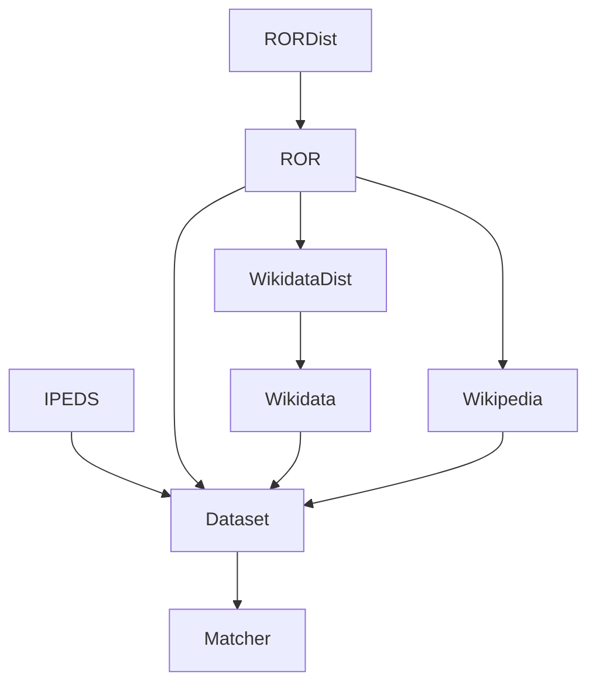

# os-institutions
Educational &amp; Research institutions dataset based on ROR, IPEDs, and Wikidata

This repository holds the pipeline that builds the institutions dataset and the
institution matcher built on top of it.

## Use as a library

```sh
pip install "os-institutions @ git+https://github.com/opensyllabus/os-institutions.git@v1.0.0"
# uv: dependencies = ["os-institutions @ git+https://github.com/opensyllabus/os-institutions.git@v1.0.0"]
```

```python
import os_institutions

matcher = os_institutions.load_matcher()   # the release matching the installed version
institution = matcher(url='https://www.harvard.edu', school_name='Harvard University')
dataset = os_institutions.load_dataset()   # pandas DataFrame, checked against the schema
os_institutions.load_matcher('latest')     # newest release; or pin: load_matcher('v1.0.0')
os_institutions.load_matcher(path='matcher.json.gz')  # a local file, no network
os_institutions.download()                 # fetch all assets, e.g. when building an image
```

> **Note:** os-institutions depends on
> [os-normalizer](https://github.com/opensyllabus/os-normalizer), which is
> still private. Until it is public, `pip install` / `uv add` works only with
> read access to that repo (SSH or token). Anyone can still download the
> [release assets](https://github.com/opensyllabus/os-institutions/releases)
> directly (see below): `matcher.json.gz` is plain gzip JSON and
> `institutions.parquet` is parquet.

Assets are downloaded anonymously, once, to `~/.cache/os-institutions/<tag>/`
(set `OS_INSTITUTIONS_CACHE` to move it), checked against the release's
`SHA256SUMS`, and reused offline. `GITHUB_TOKEN` (or `GH_TOKEN`) is optional:
set it to avoid GitHub API rate limits (`load_matcher('latest')` uses the
API) or to use a private fork or mirror. It is only sent to GitHub's API.

### Release assets

One tag per release, `vX.Y.Z`, matching the package version. Each release has:

| Asset | Contents |
|---|---|
| `matcher.json.gz` | The matcher (see "Institution matcher") |
| `institutions.parquet` | The institutions dataset |
| `crosswalk.csv` | Just the identifier crosswalk of the dataset, as plain CSV: `ror_id`, `grid_id`, `wikidata_id`, `unitid`, `name`. Same columns as `latest.csv` of the retired [institution-identifiers](https://github.com/opensyllabus/institution-identifiers) repository |
| `manifest.json` | `version`, `git_sha`, `normalizer_version`, `sources` (the lineage of the inputs: `origin` and the md5 of each stage output in `dvc.lock`), and `assets` (`sha256` and `bytes` of the matcher, the dataset, and the crosswalk) |
| `SHA256SUMS` | `shasum -a 256` of the other four files |

`crosswalk.csv` has a stable URL for scripts, without Python or parquet:
`https://github.com/opensyllabus/os-institutions/releases/latest/download/crosswalk.csv`

## Layout

| Path | Contents |
|---|---|
| `os_institutions/sources/` | Per-source pipelines: `ipeds`, `ror`, `ror_dist`, `wikidata`, `wikidata_dist`, `wikipedia` |
| `os_institutions/dataset.py` | Final institutions dataset build (merges the sources) |
| `os_institutions/loader.py` | Read, load (with schema check), and CSV export of the dataset |
| `os_institutions/schema_model.py` | Pandera schemas for every artifact |
| `os_institutions/data/` | Hand-maintained inputs: URL mappings, extra IDs, blacklists |
| `os_institutions/matcher/` | Institution matcher: build, validate, and runtime lookup |
| `os_institutions/map_null_institutions.py` | Helper to expand the `*_match_urls.yml` files |
| `os_institutions/release.py` | Library API: fetch, verify and load released assets |
| `os_institutions/runs.py` | Per-run logs written by every pipeline stage |
| `dvc.yaml`, `params.yaml`, `dvc.lock` | The DVC pipeline, its parameters, and the lock of the last run |
| `runs/`, `metrics/` | Committed run logs and per-stage metrics |
| `artifacts/` | Stage outputs (local only, git-ignored) |
| `tests/` | Unit tests (mirrors the package layout) |

## Development

Everything runs in Docker (see [`Taskfile.yaml`](./Taskfile.yaml)). Dependencies
are managed with [uv](https://docs.astral.sh/uv/) and locked in `uv.lock`.

URL and school-name normalization comes from
[os-normalizer](https://github.com/opensyllabus/os-normalizer), pinned to a release
tag in `pyproject.toml`. While that repo is private, building the image needs
read access to it: `SSH_KEY=path/to/key task docker:build` (or an ssh agent), and
`SSH_KEY=path/to/key task docker:lock:update` to change the lock. CI uses the
`OS_NORMALIZER_DEPLOY_KEY` secret.

```sh
task docker:build   # build the image
task docker:test    # run the tests
task docker:lint    # ruff check + ruff format --check
task docker:lock    # verify uv.lock is up to date
task docker:bash    # interactive shell
```

Tests that load the matcher (`tests/matcher/test_match.py`) use
`artifacts/matcher/matcher.json.gz`, which is built by the `matcher` stage and
never committed. They are skipped when it is absent, as in CI.

## Institutions dataset

Catalog of institutions based on IPEDS, ROR, and Wikidata.

### The pipeline

The stages are described in [`dvc.yaml`](./dvc.yaml) and run with
[DVC](https://dvc.org). DVC is a command-line tool in the optional `dvc`
dependency group; the library never imports it, and there is no DVC remote.
Everything below runs in Docker through the tasks, on an image built with
`task docker:build:dvc`:

```sh
task docker:repro                  # run every stage whose inputs changed
task docker:repro -- dataset       # one stage and what it depends on
task docker:repro -- --single-item dataset   # only that stage
task docker:dag                    # show the DAG
task docker:metrics                # compare stage metrics with git HEAD
```

DVC needs git, so run it from a clone (inside a `git worktree`, the main
repository's `.git` also has to be mounted into the container).

Quick start to refresh the data:

1. Bump the source pins in [`params.yaml`](./params.yaml): the ROR release
   (`ror_dist.release`), the IPEDS year (`ipeds.year`), or a
   `snapshot` label to re-query Wikidata or Wikipedia.
2. `task docker:repro`. Only the stages downstream of what changed run. The
   live-fetch stages (`ror_dist`, `wikidata_dist`, `wikipedia`, `ipeds`) need
   network access, and `wikidata_dist` and `wikipedia` take hours.
3. `task docker:metrics` to see how the row counts moved, then commit
   `params.yaml`, `dvc.lock`, `metrics/` and the new `runs/` directories.

A stage can also be run on its own, with `--input` overriding the default
upstream output:

```sh
python -m os_institutions.sources.ror build --input path/to/ror_dist.parquet
python -m os_institutions.dataset build --ror path/to/ror.parquet
```

If the build is successful, you can pass it through Pandera checks by running
the loader with the `check` argument:

```sh
python -m os_institutions.loader check
```

The same workflow applies to all pipelines.

### What is committed and what is local

| Path | Where |
|---|---|
| `dvc.yaml`, `params.yaml`, `dvc.lock` | git |
| `runs/<UTC timestamp>-<stage>/` (`run.log`, `run.json`, `summary.json`) | git |
| `metrics/<stage>.json` | git |
| `artifacts/<stage>/*` (parquet files, `matcher.json.gz`) | local only, git-ignored |
| `.dvc/cache` | local only |

Each stage logs to `runs/<UTC timestamp>-<stage>/`. `run.json` records the
git commit and whether the checkout was dirty, the Python and key package
versions, the params used, the sha256 of the inputs and outputs, and which
version of the source was used (ROR release file, IPEDS year, ...).
`summary.json` has the rows and columns of the output, and is copied to
`metrics/<stage>.json`. Nothing environment-specific is recorded: no e-mail
addresses, home or absolute paths, git remotes, or environment variables.

The oldest committed `runs/` directories are the scrubbed run logs behind the
v1.0.0 release; later ones come from rebuilds (the newest run of each stage is
the one `dvc.lock` describes).

Set `OS_INSTITUTIONS_ARTIFACTS_DIR` to keep the outputs somewhere other than
`./artifacts`. DVC is configured with `cache.type hardlink,symlink`, so the
outputs are hardlinks into `.dvc/cache` and take no extra disk space.
Hardlinks work on a Docker bind mount as long as the cache and `artifacts/`
are on the same mount (as they are here). If DVC falls back to symlinks, they
point into the container's `/opt/os-institutions` and dangle on the host.

### PR workflow

1. Run the pipeline (`task docker:repro`) and commit `runs/`, `dvc.lock`,
   `metrics/` and any `params.yaml` change.
2. Push the branch and open the PR, then run `task pr:publish` (needs
   [`gh`](https://cli.github.com); `PR=<N>` to pick a PR, `DRY_RUN=1` to
   preview). It uploads `artifacts/` and `metrics/` to a `pr-<N>` pre-release
   with a `SHA256SUMS` file, and posts or updates one PR comment with the
   stage metrics. Assets are limited to 2 GiB each.
3. The pre-release and its tag are deleted when the PR is closed or merged
   (`task pr:clean` does it by hand; `PR=<N>`, `DRY_RUN=1`). The final dataset
   and matcher are attached to a versioned GitHub release later.

### Releasing

Bump `version` in `pyproject.toml`, merge, and check out the merged commit
(a clean checkout of `origin/main`). Then run `task release:publish TAG=vX.Y.Z`
(needs `gh` and `jq`; `DRY_RUN=1` to preview). It checks that the tag matches
`version` and does not exist yet, takes `matcher.json.gz` and
`institutions.parquet` from `artifacts/`, writes `manifest.json` and
`SHA256SUMS`, and creates the release. Pass `-- --assets DIR --sources-file FILE`
to release files built elsewhere; the JSON file becomes `sources` in the
manifest. Pushing the tag runs [`release.yml`](./.github/workflows/release.yml),
which only checks it against `pyproject.toml` and reruns CI.

### Mapping null institutions

[`map_null_institutions.py`](./os_institutions/map_null_institutions.py) can
be used to expand the [`_match_urls.yml` files](./os_institutions/data/).
If desired, that job should be run before the
[final institution dataset](./os_institutions/dataset.py) build. It reads a
local CSV of domains without an institution (see
[Private data](#private-data)):

```sh
python -m os_institutions.map_null_institutions --domains <csv>
```

The extended files are written next to the originals as `*.yml.new`, or to
`--out-dir`.

Because of the way `map_null_institutions.py` works, it is possible to build
the institution dataset, [build the matcher](#institution-matcher), and then
re-run `map_null_institutions.py` to get more extra matching URLs, if desired.
This is because `map_null_institutions.py` uses the matcher to provision extra
URLs, and once those extra URLs have been built into the matcher, there are
more matching conditions to provision on.

### Working with a dataset

`os_institutions.loader.read()` is a quick way to use a dataset in a shell or notebook: it reads
the local parquet (by default the stage's output under `artifacts/`, or the
path you pass) with no checks and no run log.

On the other hand, `os_institutions.loader.load()` is the best way to use a dataset during production
runs when you want to ensure that the dataset passes its Pandera checks
(the schema is `Schema` in `os_institutions/schema_model.py`). `python -m
os_institutions.loader csv <path>` exports the dataset to CSV.

### Stage dependencies



### Distribution release schedules

| Source | Schedule |
|---|---|
| IPEDS | Yearly |
| ROR | Quarterly |
| Wikidata | Realtime |
| Wikipedia | Realtime |

### Duplicate institutions

An IPEDS institution is linked to its ROR record only through a known unitid
(Wikidata or `extra_unitids.csv`). Without it the dataset holds two records
for one institution: the ROR record without a unitid, and an IPEDS-only
record without a ror_id.
[`scripts/find_duplicates.py`](./scripts/find_duplicates.py) is a standalone
script, not part of the build: `uv run scripts/find_duplicates.py` scans a
dataset (`--input <parquet>`, default the latest release) for such pairs and
appends them to [`extra_unitids.csv`](./os_institutions/data/extra_unitids.csv);
the next build links them like any other known unitid. A pair is added when the
two records share a website domain and a name (ignoring case, `&` and
punctuation), the country and US state agree, and the pairing is one to one.
Pairs whose names differ, or that are ambiguous, get a second look on Wikidata
(the QLever mirror; `--no-wikidata` to skip): its labels, aliases, official and
short names and predecessor/successor names, for the ROR record's item and for
the item carrying the IPEDS unitid, count as names, and an ambiguous pair is
settled when the ROR item lists exactly one candidate unitid. Each added row has
a `notes` column saying why (domain, place, the names that matched and where
the match came from). Existing `extra_unitids.csv` rows are never changed.
`--report <path>` writes every candidate pair, added or skipped with the
reason, as CSV; `--no-write` only reports. Review the diff of `extra_unitids.csv` before committing.

### Blacklists

Rows that are dropped from the dataset at build time are documented in
[`os_institutions/data/blacklists/README.md`](./os_institutions/data/blacklists/README.md).

## Institution matcher

### URL keys

Each institution URL is registered under its bare domain and, for URLs with
a path, its full normalized path (`dal.ca/faculty/engineering/cift`; extension
and index pages dropped). A first-segment key (`ualberta.ca/augustana`) is
added only for a one-segment URL, or a deep URL whose first segment names the
institution, when the segment is not generic (`en`, `faculty`, `sites`, ...)
and no other institution claims it. At lookup the longest registered path
prefix wins, then the bare domain, which belongs to the institution whose URL
is that domain. See
[`matcher/url_keys.py`](./os_institutions/matcher/url_keys.py).

### Build and validate flow

1. Build a new matcher table from the latest institution dataset. This is the
   `matcher` stage, so `task docker:repro` does it, or by hand:

   ```sh
   python -m os_institutions.matcher.build
   ```

   The matcher is written to `artifacts/matcher/matcher.json.gz`: gzip-compressed JSON (no code runs on load) that records the os-normalizer version it was built with. Loading warns when the installed version differs.

2. Validate the new matcher:

   a. Against one-off institutions
      ([`matcher/data/qa.yml`](./os_institutions/matcher/data/qa.yml)):

      ```sh
      python -m os_institutions.matcher.validate qa
      ```

   b. Against a dataset of real-world institution inputs (a local parquet or
      CSV with `url`, `source_url`, `email`, `school_name`, and `count`
      columns). There is no default dataset; pass its path explicitly:

      ```sh
      python -m os_institutions.matcher.validate main --path <parquet-or-csv>
      ```

3. Inspect the generated `artifacts/validation/validation.csv` (or the
   `--output` path) to investigate potential issues.

4. Consider re-running
   [`map_null_institutions.py`](./os_institutions/map_null_institutions.py)
   (see [Mapping null institutions](#mapping-null-institutions)).

Both tools take `--matcher` to use a matcher file other than the default.

### Private data

The validation input and the domains CSV come from private syllabus metadata,
so they are never committed to this repository. Keep them outside the working
tree, for example in `~/.os-institutions/private/`, and mount that directory
read-only into the container:

```sh
docker run --rm -v $(pwd):/opt/os-institutions \
  -v ~/.os-institutions/private:/private-data:ro os_institutions \
  python -m os_institutions.matcher.validate main \
  --path /private-data/validation_input.csv
```

| File | Columns |
|---|---|
| `validation_input.csv` | `url`, `source_url`, `email`, `school_name`, `count` |
| `domains_without_institution.csv` | `domain`, `home_url` |

Empty cells are read as missing values and passed to the matcher as `None`.

### Validation on pull requests

[`validate.yml`](./.github/workflows/validate.yml) compares the PR's matcher
with the latest release's on the private sample and posts the aggregates (match
rate, institutions gained or lost, largest count changes) as a PR comment and
as `ci-validation__*` assets on the `pr-<N>` pre-release. The sample is
downloaded from S3 into the runner and deleted afterwards; nothing from it is
written, and S3 is used nowhere else. The job needs the `pr-<N>` pre-release
(`task pr:publish`) and these secrets: `VALIDATION_S3_URI` (the S3 prefix of
the sample's parquet directory), `AWS_ACCESS_KEY_ID` and
`AWS_SECRET_ACCESS_KEY` (read-only on that prefix), `OS_NORMALIZER_DEPLOY_KEY`,
and optionally `AWS_REGION`. Without them the job reports "skipped" and
passes. The same comparison runs locally on any sample:

```sh
task docker:compare -- --path .private/sample --old old.json.gz --new new.json.gz
```
