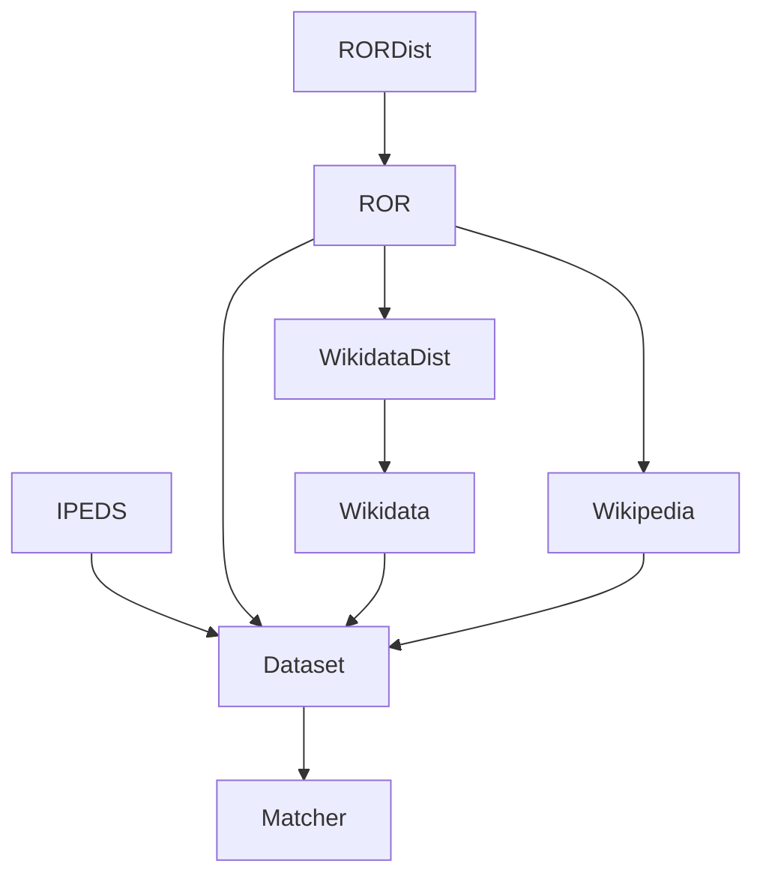

# os-institutions
Educational &amp; Research institutions dataset based on ROR, IPEDs, and Wikidata

This repository holds the pipeline that builds the institutions dataset and the
institution matcher built on top of it.

> **Status:** initial import. Weights & Biases (W&B) is still used for
> artifact storage and run tracking, and is planned to be removed (see the
> `TODO(W&B removal in PR #2)` markers below).

## Layout

| Path | Contents |
|---|---|
| `os_institutions/sources/` | Per-source pipelines: `ipeds`, `ror`, `ror_dist`, `wikidata`, `wikidata_dist`, `wikipedia` |
| `os_institutions/dataset.py` | Final institutions dataset build (merges the sources) |
| `os_institutions/schema_model.py` | Pandera schemas for every artifact |
| `os_institutions/data/` | Hand-maintained inputs: URL mappings, extra IDs, blacklists |
| `os_institutions/matcher/` | Institution matcher: build, validate, and runtime lookup |
| `os_institutions/normalizer/` | URL and school-name normalization used by the matcher |
| `os_institutions/map_null_institutions.py` | Helper to expand the `*_match_urls.yml` files |
| `tests/` | Unit tests (mirrors the package layout) |

## Development

Everything runs in Docker (see [`Taskfile.yaml`](./Taskfile.yaml)):

```sh
task docker:build   # build the image
task docker:test    # run the tests
task docker:lint    # ruff check + ruff format --check
task docker:bash    # interactive shell
```

Tests that load the matcher (`tests/matcher/test_match.py`) need the private
W&B matcher artifact and are skipped unless `WANDB_API_KEY` is set (or the
artifact is already cached under `artifacts/`).
Pass the key through from the host environment:

```sh
WANDB_API_KEY=... task docker:test
```

## Institutions dataset

Catalog of institutions based on IPEDS, ROR, and Wikidata.

### Building a dataset

Once you make changes, you can rebuild any of the datasets by running the
module with the `build` argument, for example:

```sh
python -m os_institutions.dataset build
python -m os_institutions.sources.ror build
```

If the build is successful, you can pass it through Pandera checks by running
the module again with the `check` argument:

```sh
python -m os_institutions.dataset check
```

The same workflow applies to all pipelines.

### Mapping null institutions

[`map_null_institutions.py`](./os_institutions/map_null_institutions.py) can
be used to expand the [`_match_urls.yml` files](./os_institutions/data/).
If desired, that job should be run before the
[final institution dataset](./os_institutions/dataset.py) build.

Because of the way `map_null_institutions.py` works, it is possible to build
the institution dataset, [build the matcher](#institution-matcher), and then
re-run `map_null_institutions.py` to get more extra matching URLs, if desired.
This is because `map_null_institutions.py` uses the matcher to provision extra
URLs, and once those extra URLs have been built into the matcher, there are
more matching conditions to provision on.

### Working with a dataset

`read()` is a quick way to use a dataset in a shell or notebook without
initializing a W&B run.
<!-- TODO(W&B removal in PR #2) -->

On the other hand, `load()` is the best way to use a dataset during production
runs when you want to ensure that the dataset passes its Pandera checks.

### Artifact dependencies



### Distribution release schedules

| Source | Schedule |
|---|---|
| IPEDS | Yearly |
| ROR | Quarterly |
| Wikidata | Realtime |
| Wikipedia | Realtime |

### Blacklists

Rows that are dropped from the dataset at build time are documented in
[`os_institutions/data/blacklists/README.md`](./os_institutions/data/blacklists/README.md).

## Institution matcher

### Build, validate, and deploy flow

1. Build a new matcher table from the latest institution dataset:

   ```sh
   python -m os_institutions.matcher.build
   ```

2. Update the deploy version (`ARTIFACT_NAME`) in
   [`os_institutions/matcher/__init__.py`](./os_institutions/matcher/__init__.py),
   currently `opensyllabus/institutions/matcher:v28`.
   <!-- TODO(W&B removal in PR #2): the matcher artifact moves off W&B. -->

3. Validate the new matcher:

   a. Against one-off institutions
      ([`matcher/data/qa.yml`](./os_institutions/matcher/data/qa.yml)):

      ```sh
      python -m os_institutions.matcher.validate qa
      ```

   b. Against a dataset of real-world institution inputs (parquet with `url`,
      `source_url`, `email`, `school_name`, and `count` columns). There is no
      default dataset; pass its location explicitly:

      ```sh
      python -m os_institutions.matcher.validate main --path <path-or-url>
      ```

4. Inspect the generated `validation.csv` / `institution.csv` on W&B to
   investigate potential issues. <!-- TODO(W&B removal in PR #2) -->

5. Consider re-running
   [`map_null_institutions.py`](./os_institutions/map_null_institutions.py)
   (see [Mapping null institutions](#mapping-null-institutions)).
